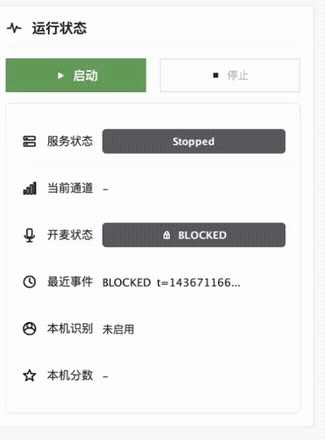

# 麦哨 · VocaGate

### 自由麦太吵，按键麦太累。让摄像头帮你按住说话键。

看见你开始说话，自动按下；说完，自动松开。

[下载安装 · 0.2.0 预览](https://github.com/klamo/VocaGate/releases/tag/v0.2.0-preview.1) · [快速上手](docs/QUICK_START.md) · [反馈问题](https://github.com/klamo/VocaGate/issues) · [English](README-en.md)

---

## 它解决什么问题？

玩游戏、开语音的时候，自由麦容易把键盘、风扇和房间里的声音一起送出去；换成按键说话，又得一直腾出一根手指。

**麦哨用摄像头观察嘴部运动，判断你是否正在说话，然后自动替你按住电脑上的「按键说话」键。** 你仍然使用原来的游戏、语音软件和麦克风，只是不用自己一直按键。

| 你在做什么 | 麦哨会尝试做什么 |
| :--- | :--- |
| 开始说话 | 提前按住你设置的说话键，减少吞掉开头 |
| 连续说话、短暂停顿 | 保持按键，尽量避免一句话被切断 |
| 说完后安静下来 | 短暂保持后松开按键 |
| 人脸丢失、连接中断或停止运行 | 关闭门控并释放按键 |

> 麦哨还在早期阶段，会有误判。它适合先在可自行设置 PTT（Push-to-Talk，按键说话）的软件中试用；不承诺兼容所有游戏或反作弊系统。

  
   
  手机与 Mac 状态联动的历史演示片段。仅展示运行状态，不代表当前安装包已完成端到端验收。

## 两种使用方式

| | 用安卓手机 | 用电脑摄像头 |
| :--- | :--- | :--- |
| **你需要** | 安卓手机 + Windows / Mac 电脑 | Windows / Mac 电脑 + 摄像头 |
| **怎么摆放** | 手机放在屏幕旁，让摄像头看清嘴部 | 使用电脑内置摄像头或 USB 摄像头 |
| **怎么连接** | 同一局域网手动 Wi-Fi 配对，或 USB 调试连接 | 无需手机 |
| **在哪里识别** | 手机本地识别，电脑接收开关状态 | 电脑本地识别 |
| **电脑负责什么** | 按住 / 松开配置的说话键 | 识别并按住 / 松开说话键 |

**手机模式不会把手机变成电脑麦克风。** 游戏或语音软件仍从你在电脑上选择的耳机、麦克风采集声音。

## 下载与安装

**[下载 0.2.0 首次预览版 →](https://github.com/klamo/VocaGate/releases/tag/v0.2.0-preview.1)**

首批安装包使用 `0.2.0` 版本号；正式下载以 Releases 中实际发布的附件为准。

| 平台 | 安装包 | 使用方式 |
| :--- | :--- | :--- |
| Android 6.0+ | `VocaGate-0.2.0-android.apk` | 下载到手机，允许对应来源安装 APK |
| macOS · Apple Silicon | 首次预览暂不提供下载 | 本轮 sidecar 检查失败，修复并验证后再发布 |
| Windows x64 | `VocaGate-0.2.0-windows-x64.zip` | 完整解压后，运行文件夹内的 `VocaGate.exe` |

- **桌面预览包已内置 Java、MediaPipe 和模型**，不需要另装 Java / Python。USB 连接目前仍需要电脑上有 ADB。
- macOS / Windows 暂无发行者签名及公证，首次打开可能出现系统提示。macOS 的本地临时签名不等于 Developer ID 签名。
- Android 的旧 debug 测试包不能直接升级为 release 包，需先卸载，原设置和测试录音会被清除；已有同签名 release 版应保留原应用。
- **安装包与 `main` 分支分开看待。** 首批二进制来自 2026 年 7 月打包；10 月的源码新增了 Android 音频辅助等改动。各包的来源、处理和验证情况见[首发说明](docs/RELEASE_0.2.0_PREVIEW.md)，不要据首页判断旧 APK 已包含全部新功能。

## 三步开始使用

### 1. 让麦哨看见你

打开电脑端，选择「本机摄像头」；或者选择「手机 VocaGate」，再按[连接指南](docs/QUICK_START.md#phone)把手机接上。让镜头能看清嘴部，先在光线较好的环境里测试。

### 2. 把两个地方的说话键设成一样

在麦哨里选择按键，例如 `CTRL+SHIFT+M`。然后到游戏或语音软件中开启「按键说话」，设置成同一个键。

macOS 需要在「系统设置 → 隐私与安全性 → 辅助功能」中允许麦哨控制键盘；使用本机摄像头还需要摄像头权限。

### 3. 点击「启动」，说一句话

先观察麦哨的开麦状态，再确认目标软件确实收到按键。停止说话、遮挡摄像头、断开手机连接，分别确认按键能释放。第一次建议和朋友试说几句，再进入正式对局。

**[查看详细安装、Wi-Fi / USB 连接与排障 →](docs/QUICK_START.md)**

## 目前有哪些功能？

以下是当前源码的能力；安装包的具体覆盖以对应 Release 说明为准。

| 功能 | 状态与说明 |
| :--- | :--- |
| 手机识别 / 电脑摄像头识别 | 两条路径均已接入；不同设备仍需验证 |
| 提前按键、连续讲话保持 | 减少吞字和短暂停顿引起的反复开关 |
| Android 音频辅助 | 给临界的视觉判断加分；**声音不能独自触发开麦** |
| 录音对比 | Android 可录制全程音频和门控音频，回放同一段话比较效果 |
| 调参 | 灵敏度、响应速度、闭麦保持、首字保护等 |
| 手机黑屏保护 | 降低亮度、停止预览刷新，继续识别；不是系统锁屏 |
| 手动 Wi-Fi / USB 连接 | Wi-Fi 填 IP 和配对码；USB 使用 ADB reverse |
| 自动发现 / 扫码配对 | 尚未实现 |

## 关于隐私与边界

- 人脸、嘴部和音频辅助分析在本机完成，识别链路不把画面或音频上传云端。手机连接电脑发送的是门控状态，不是视频流。
- Android 的「录音测试」会在手机本地保存音频；重新开始测试会替换上一轮记录。
- 当前源码仍有「检查更新」和「匿名使用统计」开关。启用后会访问配置的更新服务器；统计开关控制请求是否附带平台、应用版本和通道。它还不是完整统计平台。
- 更新模块已有哈希校验和签名验证代码，但默认调用尚未配置强制验签公钥。首次试用建议关闭算法更新，使用包内算法。
- 当前 Android 启动流程仍要求摄像头和麦克风权限；拒绝麦克风后继续纯视觉运行的体验尚待完善。
- 麦哨控制的是键盘 PTT，**不包含虚拟麦克风驱动，也不会对你的音频做降噪或唇语转文字**。

## 接下来会做什么？

- [ ] 完成独立安装包在真实设备上的 GUI、摄像头和按键链路验收。
- [ ] 改善权限引导、安装体验和故障提示。
- [ ] 加入局域网自动发现、扫码配对与内置 ADB。
- [ ] 在安装包可用后，再做可关闭的最小使用统计。

账号、支付、自动续费和完整 Care 平台不在当前开发范围内。

## 开发与参与

欢迎提交 Issue：哪台设备、哪种连接方式、在哪个软件里使用、什么情况下误开或漏开，都很有帮助。请先阅读[反馈与贡献说明](CONTRIBUTING.md)，不要上传原始录音、完整人脸画面或私有签名材料。

| 想了解什么 | 从这里开始 |
| :--- | :--- |
| 构建、运行、测试 | [开发指南](docs/DEVELOPMENT.md) |
| 安装、连接、常见问题 | [快速上手](docs/QUICK_START.md) |
| 首次发布的包和验证状态 | [0.2.0 预览版说明](docs/RELEASE_0.2.0_PREVIEW.md) |
| 打包与发布维护 | [发布指南](docs/RELEASE_PACKAGING.md) |

### 技术组成

Android 使用 CameraX + ML Kit；桌面主识别路径使用 OpenCV 采集 + MediaPipe Face Landmarker sidecar；共享门控状态机位于 `gate-core`。手机接入模式的识别始终在手机上进行。

### 开源许可

VocaGate 自有源代码采用 **[MIT License](LICENSE)**，欢迎使用、修改和贡献。第三方依赖、模型及外部素材仍遵循各自许可证，不因本仓库的 MIT 许可而改变。
